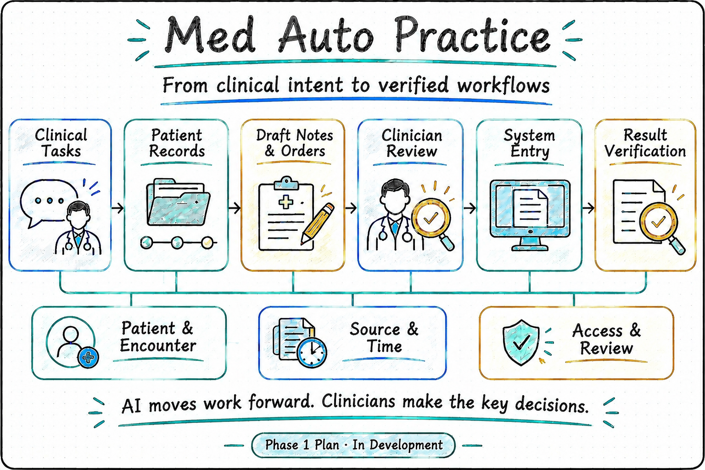

  

<strong>English</strong> | <a href="./README.md">中文</a>

<h1 align="center">Med Auto Practice</h1>

Med Auto Practice (MAP) is an open-source agent for everyday clinical work. The idea is that after rounds, you can hand off progress notes and order entry to MAP the way you would hand off a task to a colleague.

Tell MAP what needs to get done. It finds the relevant records in your hospital's existing systems and brings you the drafts, proposed changes, and supporting information for review. Once you confirm, MAP enters the approved changes, verifies what the system saved, and reports back. You make the clinical decisions and sign the records.

  

## Give MAP a task

> “Write today's progress note using my notes from rounds, last night's nursing notes, and the latest results. Let me review it first, then save the approved note in the chart.”

> “Prepare the orders for the treatment plan we just agreed on. Show me what you'd add, change, or discontinue. Once I confirm, enter the orders and check what the system saved.”

> “Update this disease cohort using our department's inclusion criteria. Add each patient's latest results and show me who's due for follow-up and what still needs checking.”

## Get started

Install **Med Auto Practice** from the OPL Software Center, or add it directly to Codex. In the public preview, you can start by organizing records you already have. Inpatient progress notes and order changes are the first priorities for hospital integration. Disease cohorts and follow-up are planned for a later stage. [Installation guide](docs/getting-started.md) · [Development progress](docs/roadmap.md)

[Hospital setup](docs/hospital-adapters.md) · [Developer guide](docs/adapter-development.md) · [Contributing](CONTRIBUTING.md) · [Apache-2.0 license](LICENSE)
