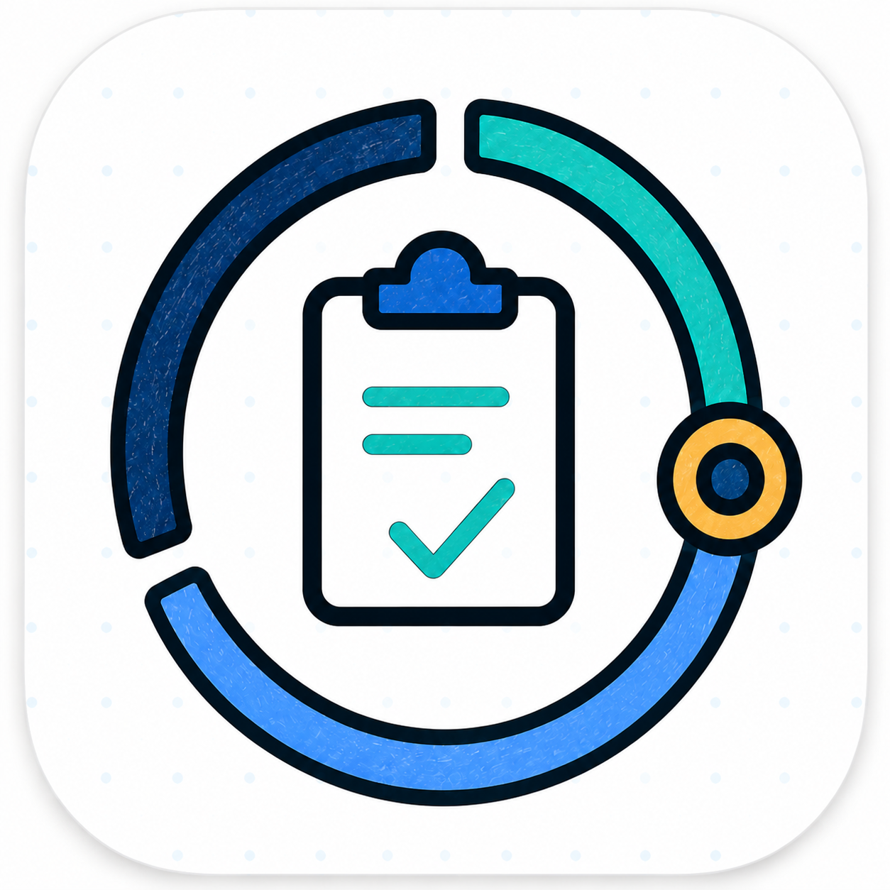
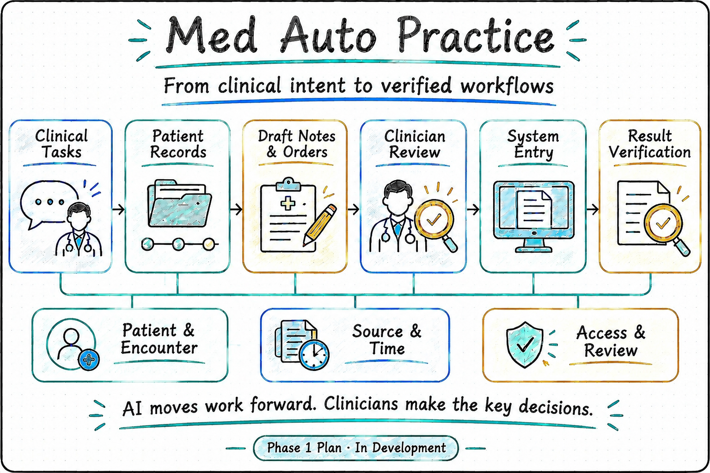

  

<a href="./README.en.md">English</a> | <strong>中文</strong>

<h1 align="center">Med Auto Practice</h1>

Med Auto Practice（MAP）是面向医生的开源临床工作智能体。它帮你把散在病历、检验报告和护理记录里的资料整理到同一次就诊下，写出有据可查的病程草稿，把需要判断的变化和医嘱留给你审阅。

你可以带着已有资料开始，也可以让 MAP 帮你接入本院系统。它会先看这项工作已经能从哪里取数，再和你一起补齐缺的那一步。下一次处理同类任务时，MAP 会沿用本院已经验证的接入方式。

  

## 从一项临床工作开始

> “把这份既往病历整理成时间线。诊断、用药和检验结果标出来源，有矛盾的地方单独列给我。”

> “我想用本院检验结果写住院病程。信息科有集成平台，先帮我在测试环境取回一项结果，核对就诊、单位和报告时间。”

> “继续上次那批待审医嘱，先给我看拟变更的内容和依据。”

整理已有资料时，MAP 先给出结构化病历和待核实项，保留原文供回看。需要院内取数时，它优先复用获准的原生接口或院内中间件。有业务界面可用时，可通过 Computer Use 操作浏览器或桌面，隔离终端也可选用 IP KVM。医嘱工作流由医生审阅确切版本，提交后再从医院系统读回结果供医生核对。

## 使用与开发

在 OPL 软件中心安装 **Med Auto Practice**，或将插件直接安装到 Codex。在新对话里告诉 MAP 你要完成哪项工作。公开版附有可运行的合成病例、部署档案和 FHIR 检验取数示例，院内工作流按本院授权和验证结果启用。[安装与上手](docs/getting-started.md) · [医院接入示例](docs/hospital-adapters.md)

开发者可以接入本院中间件、桌面宿主或医学提案组件，沿用 MAP 的患者与就诊绑定、医生复核和结果回读流程。[系统适配与二次开发](docs/adapter-development.md) · [架构](docs/architecture.md) · [产品范围](docs/product.md) · [贡献指南](CONTRIBUTING.md) · [Apache-2.0 许可证](LICENSE)
